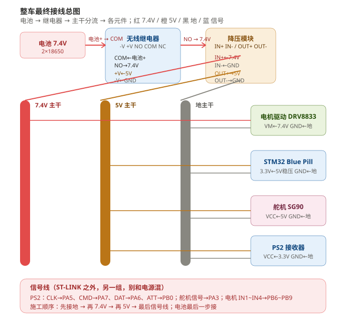
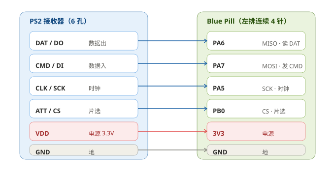
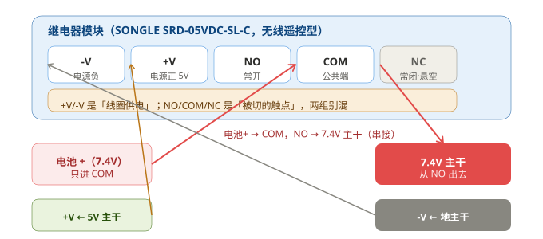
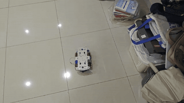
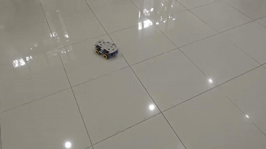
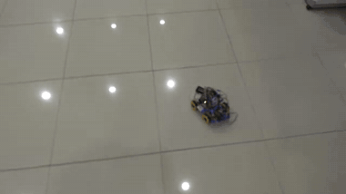

# CRTC2026 · 机器人总动员战队

重庆大学机器人训练大赛（CRTC2026）新生组参赛工程仓库。

队伍：机器人总动员战队（英文 Robot Mobilization），5 名队员，均为重庆大学 2026 级本科生。

---

## 目录

- [队里谁做了什么](#队里谁做了什么)
- [从哪份文档开始看](#从哪份文档开始看)
- [想自己复现一台](#想自己复现一台)
- [文档索引](#文档索引)
- [中期考核要交的东西在哪](#中期考核要交的东西在哪)
- [文档格式怎么对照的](#文档格式怎么对照的)
- [这台车是什么样的](#这台车是什么样的)
- [录像](#录像)
- [技术参数](#技术参数)
- [现在的状态](#现在的状态)
- [目录结构](#目录结构)
- [用法备忘](#用法备忘)

---

## 队里谁做了什么

五个人的活是这样分的。「记录人」只写文档里明确署了名的；没署名的两摊是几个人一起干的，文档里没有单列人名。

| 工作线 | 记录人 | 主要做了什么 | 对应的文档 |
|---|---|---|---|
| 电控 + 物资 | 陶家宇（队长） | 底盘麦轮解算与防滑、PS2 手柄通信、舵机通道、电源与驱动接线；官方物资清点、缺口计算、采购与成本核算 | [工程日志](docs/工程日志.md) · [实践记录](docs/实践记录_底盘与电控.md) · [03 底盘](docs/03_底盘运动与麦轮防滑.md) · [05 手柄](docs/05_PS2手柄与遥控器.md) |
| 电气 | 王紫怡、李海洋 | 从零学焊接；洞洞板布线与三路电源隔离、主控与驱动排母、电机驱动信号桥、全链路电压验证 | [10 电气组工作日志](docs/10_电气组工作日志_王紫怡.md) · [04 电源硬件与焊接](docs/04_电源硬件与焊接.md) |
| 机械 | 李宝怡、袁文垚 | 两层底盘与麦轮平台、A 车铲斗拾取机构、B 车双杆平行夹爪机械臂；超重、轮子干涉、支架强度三个问题的复盘 | [11 机械组设计报告](docs/11_机械组设计报告_李宝怡.md) · [02 机械结构与3D打印](docs/02_机械结构与3D打印.md) |
| 打印与装配 | 未单独署名 | 25 个结构件 + 14 个外观件的切片与打印、金属底板适配、整车装配 | [3D打印交付](3D打印交付/) · [02 机械结构与3D打印](docs/02_机械结构与3D打印.md) |
| 规则与赛务 | 未单独署名 | 手册拆解、得分规则量化、走桥战术定案、中期自查与提交 | [01 规则拆解与战术选型](docs/01_规则拆解与战术选型.md) · [09 结构稳定性成本与中期自查](docs/09_结构稳定性成本与中期自查.md) |

这些日志不是五份各交各的材料。手册要求的是「按功能分板块」，所以最终成稿是 [工程日志](docs/工程日志.md) 这一份主日志——十三个功能板块，一个功能一节，谁做的内容就由谁写进对应那一节，各组的详细过程留在自己的分册里作为支撑。

---

## 从哪份文档开始看

- 想先知道**做到了哪一步、哪些是真跑通的**：[00 总览与时间线](docs/00_总览与时间线.md)。
- 想看**每个功能是怎么一步步试出来的**：[工程日志](docs/工程日志.md)，这是主提交文档。
- 想看**电控这一摊踩过哪些坑**：[实践记录_底盘与电控](docs/实践记录_底盘与电控.md)，第一人称写的。
- 想查**用了谁的代码、什么许可**：[开源项目说明](docs/开源项目说明.md)。

---

## 想自己复现一台

给下一届、或者想抄一部分过去的队伍：一篇从零到能跑的完整路径，在 [复现指南](docs/复现指南.md)。

里面写了买什么（含实际花了多少钱）、环境怎么搭、克隆版 ST-LINK 怎么烧、三路电源怎么接、单个轮子怎么验、麦轮解算为什么把「各自限幅」改成「整体等比缩放」才走得直、舵机怎么先标定再装机构，最后是踩过的坑——一共 15 条，包括「官方材料在真实场地上不一定够用」「接线一条线路一个颜色」「备件要按会坏来备」「组队规矩第一周就要立」。篇幅不短，顶部有目录，可以按需跳。

有一句写在开头也写在结尾：**哪些是实测跑过的，哪些还是纸上的，分开写**。2 号车和机械臂都在后者里，别当成品抄。

组委会和战队发下来的原始文件也放进仓库了——参赛手册 V1.7、两份培训 PPT、SG90 的 STEP 模型，见 [参考资料存档](docs/refs/README.md)。

---

## 文档索引

| 文档 | 讲什么 |
|---|---|
| [工程日志](docs/工程日志.md) | 主日志，13 个功能板块，一个功能一节 |
| [00 总览与时间线](docs/00_总览与时间线.md) | 进度总表、文档索引、真实性声明 |
| [01 规则拆解与战术选型](docs/01_规则拆解与战术选型.md) | 得分规则量化、走桥战术、为什么放弃爬坡 |
| [02 机械结构与3D打印](docs/02_机械结构与3D打印.md) | 尺寸红线核算、分层结构、打印件设计 |
| [03 底盘运动与麦轮防滑](docs/03_底盘运动与麦轮防滑.md) | 麦轮解算、归一化限幅、死区、斜坡、电压补偿 |
| [04 电源硬件与焊接](docs/04_电源硬件与焊接.md) | 电源树、继电器取电、DRV8833 改造、5V 塌陷 |
| [05 PS2手柄与遥控器](docs/05_PS2手柄与遥控器.md) | SPI 模式 3、DI/DO 接反、掉线保护、按键映射 |
| [06 舵机机构与抓取](docs/06_舵机机构与抓取.md) | 序列器、舵盘转接板、夹爪、挑杆、探杆 |
| [07 方块携带与储仓](docs/07_方块携带与储仓.md) | 斜槽自锁、单向挡板、多块携带 |
| [08 半自动与视觉](docs/08_半自动与视觉.md) | 机械对中与视觉的取舍、宏状态机、K210 |
| [09 结构稳定性成本与中期自查](docs/09_结构稳定性成本与中期自查.md) | 跌落、尺寸复核、成本、考核自查表、视频脚本 |
| [10 电气组工作日志](docs/10_电气组工作日志_王紫怡.md) | 电气组 10/05–10/19：焊接、电源站、信号桥、排障 |
| [11 机械组设计报告](docs/11_机械组设计报告_李宝怡.md) | 机械组：两车分工、底盘平台、A 车铲斗、B 车夹爪 |
| [实践记录_底盘与电控](docs/实践记录_底盘与电控.md) | 电控这一摊的第一人称复盘 |
| [复现指南](docs/复现指南.md) | 从零到能跑的完整路径：采购、环境、烧录、接线、解算、15 条坑、组队经验 |
| [参考资料存档](docs/refs/README.md) | 组委会发的原始文件：手册 V1.7、电控培训、机械培训、SG90 模型 |
| [开源项目说明](docs/开源项目说明.md) | 开源引用、作者、链接、许可、改了什么 |
| [进阶功能方案](docs/进阶功能方案.md) | 3 项进阶功能的设计与预算 |
| [调参指南](docs/调参指南.md) | 现场调参手册（8 步 + 症状速查 + 两套预设） |
| [硬件接线与焊接指南](docs/硬件接线与焊接指南.md) | 引脚总表、焊接点位、分步上电检查、故障速查 |
| [接手交接_接线与排障手册](docs/接手交接_接线与排障手册.md) | 给接手同学：三条主干接线 + PS2 不传信号 / ST-Link 无法脱机 两个问题的排查步骤 |
| [接线总图](#接线总图) | 图形化速查：整车总览、PS2 一对一、继电器 5 端子丝印 |
| [视觉模块选型与采购](docs/视觉模块选型与采购.md) | K210 选型对比、接线、调试五步 |
| [半自动与全自动操作手册](docs/半自动与全自动操作手册.md) | 三档模式、五个宏、全自动参数标定 |
| [坡道上不去与功率不够](docs/坡道上不去与功率不够_诊断与对策.md) | 爬坡失败的完整诊断：扭矩、摩擦、电压、电流 |
| [批判与修正记录](docs/批判与修正记录.md) | 被推翻的判断、改口的原因，一条条留着 |
| [代码说明_先看这个](docs/代码说明_先看这个.md) | 代码导读 |
| [代码文件清单](docs/代码文件清单.md) | 逐文件清单 |
| [两车设计与调试工作日志](docs/2026-10-19_两车设计与调试工作日志.md) | 2026-10-19 当天两车的设计与调试记录 |
| [现在该干什么](docs/现在该干什么.md) | 内部操作备忘 |

---

## 中期考核要交的东西在哪

| 考核项 | 在哪 | 说明 |
|---|---|---|
| 基础功能 12 项逐条对照 | [09 · 中期考核自查表](docs/09_结构稳定性成本与中期自查.md) | 每项标了现有素材和完成状态 |
| 尺寸复核（290 / 195 / 210 / 445 / 400 / 450） | [09 · 尺寸复核](docs/09_结构稳定性成本与中期自查.md) | 设计值标设计值，实测值待回填 |
| 180mm 跌落测试 | [09 · 跌落测试](docs/09_结构稳定性成本与中期自查.md) | 方案已定，结果待实测 |
| 成本核算 | [09 · 成本核算](docs/09_结构稳定性成本与中期自查.md) · [工程日志 四](docs/工程日志.md) | 以实际报销单为准 |
| 视频脚本与拍摄要求 | [09 · 视频拍摄脚本](docs/09_结构稳定性成本与中期自查.md) · [录像索引](docs/videos/README.md) | 1080p / 30fps / mp4 |
| 开源项目四要素 | [开源项目说明](docs/开源项目说明.md) | 项目、作者、链接、许可、改了什么 |
| 文档格式与命名 | 见下一节 | 手册 4.3.1 逐条对照 |
| 邮件提交清单 | [09 · 邮件提交清单](docs/09_结构稳定性成本与中期自查.md) | 主题格式与收件人写在里面 |

---

## 文档格式怎么对照的

对照手册 4.3.1 的要求：

| 手册要求 | 我们的做法 |
|---|---|
| 以 `.md` 格式提交 | 全部为 Markdown |
| 按设计进度从早到晚组织 | 工程日志与各分册均按推进顺序排列 |
| 一个机器人功能 = 一个板块，标题为 H2，正文写功能描述与开发历程 | 主日志每节一个 H2，正文分「功能描述」「开发历程」 |
| 每篇文档由若干板块组成 | 主日志含 13 个功能板块 |
| 用了开源项目须在文档末尾完整说明 | 见 [开源项目说明](docs/开源项目说明.md)，主日志末节也做了指引 |
| 仓库名用队伍名称的英文/拼音 | `CRTC-Robot-Team` |
| 所有文档放在仓库根目录的 `docs/` | 根目录只留本 README |

---

## 接线总图

从电池到四个负载的完整走线，一眼看清。三张图都放大不糊，也可以右键存下来打印。

**整车总览**（红 7.4V / 橙 5V / 黑 地 / 蓝 信号）



**PS2 接收器 ↔ Blue Pill**（DI 接 PA7、DO 接 PA6，接反是 90% 连不上的原因；VCC 只能 3.3V）



**无线继电器**（5 端子 `-V +V NO COM NC`：COM 接电池正、NO 接 7.4V、+V 接 5V、-V 接地、NC 悬空）



---

## 这台车是什么样的

两台一样的四轮底盘，车体 236 × 162 × 148 mm，装上收集铲之后整车长 283 mm，而规则红线是 290 mm —— 这是全车里最紧的一个数，只留了 7 mm 余量。

1 号车用麦克纳姆轮，负责地面和桥下通道这些需要精确对位的地方；2 号车换成橡胶轮，负责爬 26.57° 的坡道。这么分工的原因很实在：没有任何一种轮子能同时做到「全向精确」和「能爬陡坡」。麦轮在地胶上的摩擦系数只有 0.5 到 0.7，而爬那个坡刚刚需要 0.50，几乎没有余量；橡胶轮摩擦够，但它不能横移。所以让两台车各拿一头。

半自动对位没有做视觉，走的是机械对中（V 型口加两个微动开关）。理由是：对中失败的模式是「没对准」，重来一次就行；视觉失败的模式是「对准了错的目标」，既费时间又可能撞车。

---

## 录像

点开就能动，不用下载。下面三段是动图预览，完整版在 [`docs/videos/`](docs/videos/README.md)（720p，带原声）。

**第一次成功平移**，8 秒 ｜ [完整版](docs/videos/01-第一次成功平移.mp4)



**底盘全向动作**，47 秒 ｜ [完整版](docs/videos/02-底盘全向动作演示.mp4)



**原地转弯**，41 秒 ｜ [完整版](docs/videos/03-原地转弯测试.mp4)



原片是手机拍的 HEVC，部分播放器不认，仓库里的已统一转成 H.264。现场对话没剪。

---

## 技术参数

| 项 | 值 |
|---|---|
| MCU | STM32F103C8T6 @ 72MHz |
| 底盘 | 4 × TT 马达(1:48) + 4 × 60mm 麦轮，轴距 180 / 轮距 136 mm |
| 驱动 | DRV8833 ×2（PHASE/ENABLE 接法），PWM 10kHz |
| 舵机 | MG995 ×1（大臂）+ SG90 ×3，PWM 50Hz |
| 遥控 | PS2 无线手柄，SPI 模式 3，281kHz |
| 电源 | 2 × 18650 串联（7.4V）→ 无线继电器 → 电机直供 + 5V 降压 |
| 控制周期 | 底盘 5ms / 舵机 10ms / 日志 200ms |
| 半轴距 / 半轮距 / 轮半径 | 0.090 / 0.068 / 0.030 m |

---

## 现在的状态

文档写于 10 月 24 日，下面是当时的真实状态。

| 交付物 | 状态 |
|---|---|
| 开发环境与工具链 | 实测通过（CubeIDE 2.2.0 + gcc 14.3.1 + OpenOCD） |
| SWD 烧录链路 | 实测贯通。克隆版 ST-LINK 要用 `interface/stlink-dap.cfg` |
| 1 号车底盘 | 四个轮子全部跑通，麦轮五种动作都能做出来 |
| 1 号车舵机 | 后期补齐，PA3 / TIM2_CH4，50Hz，实测 1500→1800→1200 正常 |
| 1 号车电源 | 无线继电器、双 DRV8833、5V 降压全部接好并通过上电检查 |
| 2 号车 | 无实物，方案停在设计稿 |
| 机械臂（柱坐标三自由度） | 模型和 STEP 出完了，没打印、没装配，最终未采用 |
| 3D 打印件 | 已出 G-code，实打了一部分 |
| 调试与演示录像 | 三段，见 [docs/videos](docs/videos/README.md) |

---

## 目录结构

```
CRTC-Robot-Team/
├── README.md                    本文件
├── docs/                        全部文档（文档评估的提交内容）
│   ├── 工程日志.md               主日志：13 个功能板块，一个功能一节
│   ├── 00_总览与时间线.md         进度总表、文档索引
│   ├── 01 ~ 11                   各功能分册（见上面的文档索引）
│   ├── 实践记录_底盘与电控.md      电控这一摊的第一人称复盘
│   ├── 复现指南.md                从零到能跑：采购、烧录、接线、解算、坑、组队
│   ├── 开源项目说明.md            开源引用与许可
│   ├── 调参指南.md                现场调参手册
│   ├── 硬件接线与焊接指南.md       引脚总表与焊接点位
│   ├── 半自动与全自动操作手册.md    三档模式与宏
│   ├── 坡道上不去与功率不够_诊断与对策.md
│   ├── 批判与修正记录.md          被推翻的判断与改口原因
│   ├── images/                   实物照片、图纸、动图预览
│   ├── videos/                   调试与演示录像（含索引）
│   ├── refs/                     组委会原始资料：手册 V1.7、培训 PPT、SG90 模型
│   └── 物料与发票/                采购凭证（含个人信息，未公开，另行提供）
├── firmware/                     自研主固件（含舵机 / 机械臂 / 半自动宏）
│   ├── Core/Inc/                   board.h 引脚映射 / config.h 全部可调参数
│   ├── Core/Src/                   app.c 总调度 / mecanum.c / motor.c / ps2.c
│   │                               servo.c / arm.c / sensor.c / vision.c / auto_task.c
│   ├── Core/Inc/hal_shim.h + Src/hal_shim.c   HAL 兼容层（纯寄存器，不依赖官方库）
│   ├── Core/Src/startup_stm32f103xb.c         用 C 写的启动文件
│   └── STM32F103C8TX_FLASH.ld                 链接脚本
├── firmware_v2/                  实车烧录的底盘固件（车一现在跑的就是它）
│   ├── README.md                   引脚表、相对原包的改动、编译烧录、验证边界
│   ├── src/                        board / ps2_bus / robot_control / servo_lift / startup
│   │                               selftest_main.c 四轮自检 / demo_main.c 整车演示
│   └── STM32_PS2_Mecanum.uvprojx   Keil 工程（备选，默认走 tools/build_v2.py）
├── cpp/                          C++ 版运动 / 机械臂 / 视觉（能在电脑上离线跑）
├── mechanical/                   3D 打印件参数化生成脚本 + STL + 图纸
├── 3D打印交付/                   拷去打印机就能开工（含已切好的 G-code）
├── tools/                       自研工具链
│   ├── build.py / build_cpp.py / build_v2.py
│   ├── flash.py                    一键烧录（check / motion / arm / ps2 / full）
│   ├── slice_k1.py / check_gcode.py 自研切片器与切片自检
│   ├── gen_step.py                 导出 STEP 给机械组改模型
│   ├── check_wiring.py             引脚冲突静态检查
│   └── sim/                        离线仿真
└── vision/
    └── k210_find_cube.py           K210 MaixPy 色块识别（进阶功能备选）
```

---

## 用法备忘

- 刷固件前先改 `config.h` 里的 `ROBOT_ID`（1 = 1 号车，2 = 2 号车）。
- `firmware_v2` 有两套电机极性符号，车一和车二不一致，`--car2` 编出来的固件只能烧车二。
- 文档里所有标了 `【待实测】` 的地方，都是还没量过的设计值。实测之后必须替换成真实数据，不能拿算出来的数当量出来的数。
- 电源仍然遵守「单一供电、额定 ≤7.4V」，不上 3S、不上双电池组。
