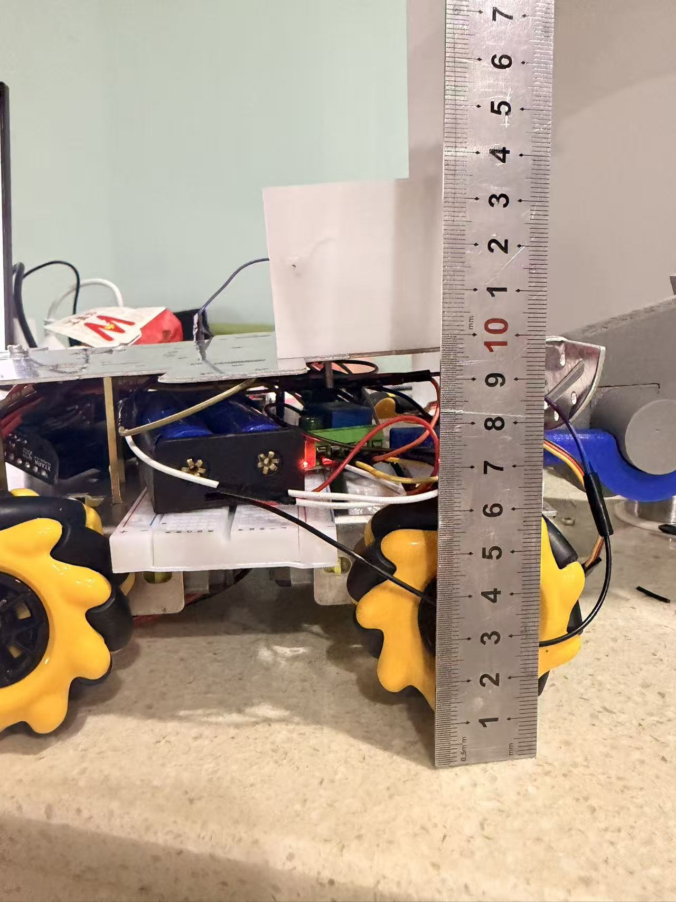
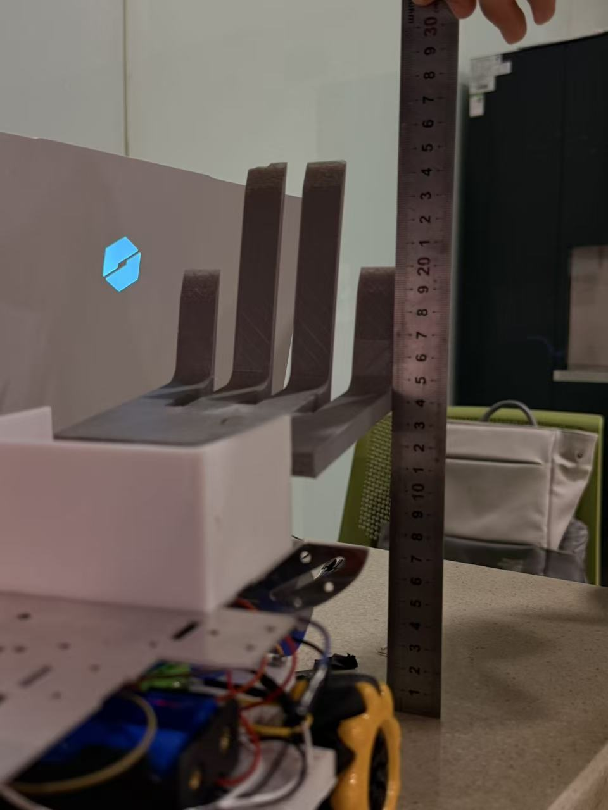
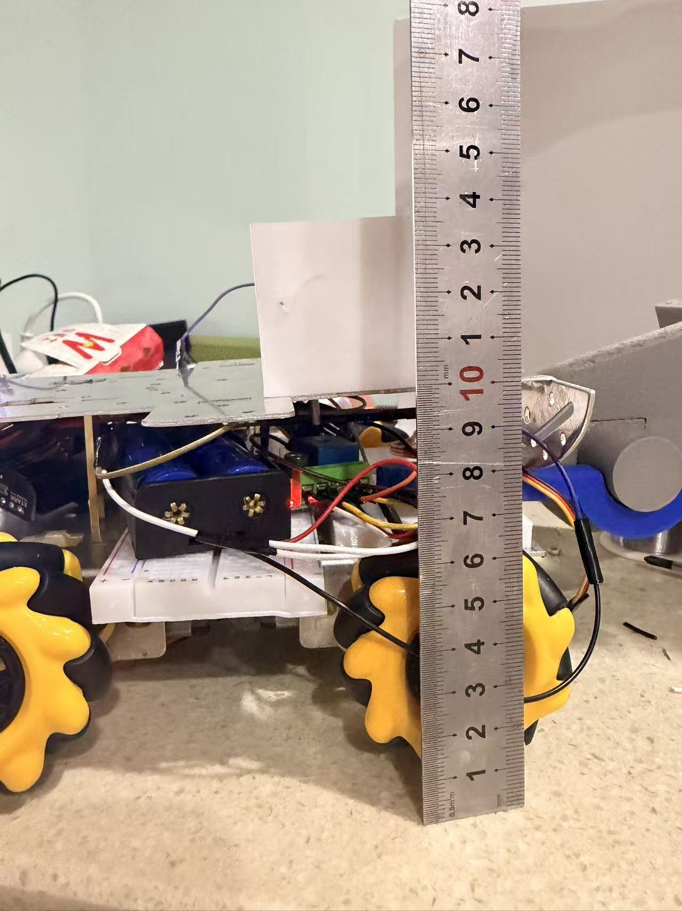
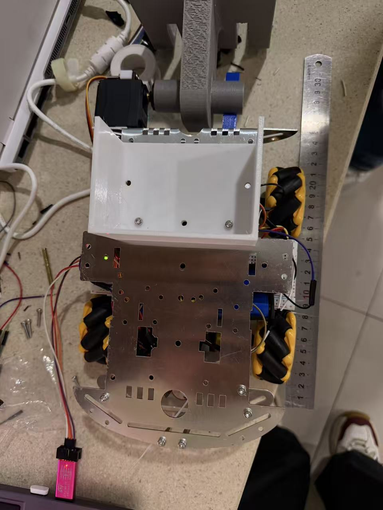

# 结构稳定性、成本与中期考核自查

## 功能描述

把手册里几条"不过就完蛋"的硬指标（跌落、尺寸、成本）逐条落实并留证，
最后给出中期考核的自查清单和视频拍摄脚本。

---

### 180mm 跌落测试（方案已定，结果【待实测】）

> ⚠ 2026-10-04 清理：此前这里写了「第一次不合格、第二次合格」的实测结论，
> 那是预写的假记录（当天车还没装完）。已改为方案 + 空白待填。

手册 3.3.3 的检测方法：

> 参赛前机器人将在检录区接受结构强度检测，检测方法为使机器人从高 150mm-200mm 处
> 以底面朝下的初始姿态自由下落，无零件掉出则视为检测合格。

我们按最严的 **180mm** 做（考核指标里写的就是 180mm）。

**预判的风险点（装完车要重点看）**：夹爪指只用一颗 M2.5 螺丝固定，
落地冲击可能让 PLA 的螺丝孔**扩孔**、螺丝脱出。

**预防对策（装车时就按这个做，别等摔了再改）**：

1. 螺丝孔改成**穿通孔 + 螺母**（原来是直接自攻进 PLA）
2. 夹爪指填充率从 25% 提到 **45%**，壁厚 1.6mm
3. 舵机与转接板之间加一层薄双面胶，吸收冲击

**实测结果**：【待填】次数 / 有无零件脱落 / 机构角度有无变化
（做的时候拍视频，尺子要入镜）

> 顺带一个发现：**电池是全场最容易掉的东西**。
> 两节 18650 + 盒子约 100g，落地冲击很大。我们用电池卡箍 + 一根扎带双重固定，
> 并且卡箍装在甲板**下方**（顺便降低重心）。

### 尺寸复核（【待实测】）

用钢直尺 + 游标卡尺实测（视频里要拍到尺子读数）：

> ⚠ **下面「设计值」那列是我按模型算的，不是量出来的。**
> 车还没装起来，不可能有实测数。**提交中期考核前必须自己量一遍填进「实测」列**，
> 视频里要拍到尺子读数。别把设计值当实测交上去。

| 项目 | 规则 | 设计值（算的） | 实测（自己量，必填） | 结论 |
|---|---|---|---|---|
| 长 | ≤ 290 mm | **283 mm**（金属板实测 255 + 铲前伸 28） | ____ mm | **待实测，余量只有 7mm** |
| 宽 | ≤ 195 mm | 162 mm（甲板宽） | ____ mm | 待实测（板实测宽 150） |
| 高（初始/检录姿态） | ≤ 210 mm | 148 mm | ____ mm | 待实测 |
| 高（机构全展开） | ≤ 450 mm | 205 mm | ____ mm | 待实测 |
| 长 × 宽（展开） | ≤ 445 × 400 | 236 × 162 | ____ × ____ mm | 待实测 |
| 550mm 球约束 | 不超出 | 远小于 | ____ | 待实测 |
| 重量 | ≤ 2.0 kg | 逐项核算 ≈ 1076 g | ____ g | 待实测 |

> **金属板实测（2026-10-04，尺子量的，±1mm）**：长 255mm ｜ 宽 150mm ｜ 高 27mm ｜ 厚 1.5mm，
> 板上现有 Φ4 和 Φ5 两种螺丝孔。电机：外径 Φ20、输出轴离地 25mm、法兰孔距 16.5mm。
>
> ⚠ **车长是最紧的一条**：283 vs 290 只剩 7mm。这是收集铲进深从 90 砍到 28 的原因。
> 装完保险杠和铲之后**必须再量一次**，超了就把铲往后挪（安装槽已经留了调节量）。
>
> 设计值里「高 148mm」是 L2 层顶（含车头上方收起状态的夹爪 + 大臂），
> 见 `docs/02` 的层高表。它**算进了大臂**，但大臂收起姿态到底多高取决于舵机标定，
> 所以这一项尤其要实测——标定错了它是最容易超 210 的一项。

> 核算表见 `docs/02`「重量是逐项算出来的」。
> **装完车第一件事就是上秤**，把实数填回这里——这是全车唯一一个"算错就要命"的数。
> 秤出来 >1.6 kg 说明有件比预期重，先查金属底板和电池；接近 2.0 kg 就别再加配重了。

**"初始姿态"的定义要抠准**：手册说"初始尺寸指每次对局正式开始时机器人的尺寸"。
所以检录时必须是**机构全收起**的姿态。
我们在 `servo.c` 的 `Servo_Init()` 里上电就下发 `POSE_STOW`，
并且给操作手定了死规矩：**每局开始前按一次 L1**（全机构收起）。

### 编号贴纸的注意事项

手册 3.3.1：

> 除组委会提供的指定数字贴纸外，参赛队不可在机器人的其他结构上粘贴相似的贴纸，
> 且机器人机身上的其他装饰性贴纸也不得包括明显的与指定编号不同的数字。

我们原本打算在车顶贴一个大的队伍 logo，里面有个"2026"的字样 —— **这个要改**。
任何明显数字都可能被判违规。最终方案：车顶只贴纯图形 logo，**不带任何数字**。

### 成本核算（以实际报销单为准）

到 2026-10-13 为止，全队实际采购 **16 项物料、7 张电子发票，合计 ¥405.80**。
其中 ¥3.80 是发票附带的价外费用，**纯物料 ¥402.00**。

| 口径 | 金额 |
|---|---|
| 实际开票总额（报销单投递号 8411990） | **¥405.80** |
| ├ 纯物料 | ¥402.00 |
| └ 价外费用（第 1 张发票附加） | ¥3.80 |
| 无线继电器 ×2（中期后买，不计入本轮） | ¥27.60 |
| 3D 打印件（按原料价计，一卷 PLA 约用 1/4） | ≈ ¥15 |
| **中期之后预计累计** | **≈ ¥448** |

按用途拆开：电控 ¥289.40（71.3%）、机械 ¥98.40（24.3%）、硬件 ¥14.20（3.5%）、价外费用 ¥3.80（0.9%）。
按属性拆：耗材 ¥300.64、工具 ¥101.36（手柄 / 充电器 / ST-LINK 三样可复用）。

16 项明细和 7 张发票的对应关系写在 `docs/工程日志.md` 的「四、物资采购与成本」第六步；
物料清单原件在 `docs/物料与发票/物料清单.xlsx`。
发票集与报销单含个人信息（姓名、手机号、银行卡号），未放入公开仓库。

**手册第 8 页有两条约束，措辞不同，别混：**

| 条款 | 原文措辞 | 性质 |
|---|---|---|
| 新生组造价 | 「不**推荐**超过【400.00】元」 | 造价口径，软约束 |
| 报销金额 | 「总报销金额**最大不超过**【400.00】元」 | 报销口径，硬线 |

本轮实际开票 ¥405.80，比报销硬线高 **¥5.80**。
后面还要买无线继电器（¥27.60）和可能的 1:120 马达、橡胶轮，这部分要单独核算，别继续叠加。

**另外两条省钱的既定做法**（不变）：

- 无线继电器**过了中期考核再买**，中期前不计入；
- 3D 打印件只算原料价（手册 3.3.4：「对于所有购买原料自己加工产品的情形，
  以购买发票为准仅将其原料价格计入制造成本」）—— 一卷 PLA+ ¥60 我们只用了约 1/4，计入 **¥15**。
  但「计入成本」和「你实际掏的钱」是两回事：报销认 ¥15，买整卷要花 ¥60~80。

> 报销上限 ¥400，**未通过中期考核的队伍不予报销**。
> 所以中期考核不只是晋级资格，也直接决定这笔钱能不能回来。

### 中期考核自查表（逐条【待做】）

#### 基础功能 12 项（逐条对照现有素材）

> 状态按 2026-10-19 手里的照片和视频核过一遍。「✅ 可报」= 素材能直接证明；
> 「⚠ 素材不足」= 有画面但证不了这个指标；「❌ 没拍」= 完全没素材。

| # | 指标 | 状态 | 现有素材 | 还缺什么 |
|---|---|---|---|---|
| 1 | 外形展示 | ✅ **可报** | 整车多角度照片 4 张（`images/chassis-overview-1/2.jpg`、`chassis-top-view.jpg`） | 最好补一段 15s 绕车一周 |
| 2 | 电机运动（单一） | ⚠ 素材不足 | 无 | 架空拍单轮转，10s |
| 3 | 电机运动（全部） | ⚠ 素材不足 | 无 | 架空拍四轮同转，10s |
| 4 | 舵机运动（单一） | ⚠ 素材不足 | 有舵机接线视频，但舵机本体不在画面里 | 拍夹爪开合，10s |
| 5 | 舵机运动（多项） | ❌ 没拍 | 机械臂尚未全部装齐 | 三舵机停中位、手掰不动，20s |
| 6 | 底盘运动（单一） | ✅ **可报** | PS2 手柄与整车同框、车确实在动（31.7s） | 无 |
| 7 | 底盘运动（全部） | ❌ 没拍 | 只有一台车在镜头里 | 两台车同时动 |
| 8 | 尺寸规范 | ✅ **可报** | 钢尺量高 3 张照片 | 补量车长、车宽各一张读数照片 |
| 9 | 方块携带（单一） | ❌ 没拍 | 无 | 地面静态方块 → 携带 |
| 10 | 方块携带（多项） | ❌ 没拍 | 无 | 保持第一块再拿第二块 |
| 11 | 结构稳定性 | ❌ 没拍 | 无 | 180mm 自由跌落，尺子入镜 |
| 12 | 规划 / 现有采购单 | ✅ **可报** | 物料清单 16 项 + 报销单 7 张发票，合计 ¥405.80 | 无 |

**按现在的素材，能报 4 项（1 / 6 / 8 / 12）。**

#### 尺寸实测照片

设计值：长 **283** × 宽 **150** × 高 **204.6**（红线 290 × 195 × 210），三向都在范围内。

> ⚠ 拍正式版时把尺子的**零刻度压在测量基准面**上，读数要能一眼看清，别让手挡住刻度。

#### 进阶功能 3 项（每项满分 3 分，取创新度/实现难度/完成度均值，最高 +9）

| # | 名称 | 创新点 | 为什么不等同于基础功能 |
|---|---|---|---|
| 1 | **斜槽重力自锁多块储运仓** | 单向挡板 + 5° 前低后高，一次带 3 块，急停/横移/跌落都不掉 | 基础功能只考核"携带多项"，本项考核的是**任意姿态下的自锁可靠性**，并给出量化测试 |
| 2 | **机械对中半自动收集宏** | 不用视觉，纯靠 V 型口 + 双微动开关 + 时间窗口判定实现半自动 | 基础功能只要求"能携带"，本项实现了**无需操作手精细操作的完整动作序列**，并用超时 + 人工接管保证安全 |
| 3 | **坡道防滑可收放摩擦支撑块** | SG90 驱动的撑地块，上 26.6° 坡时放下增加正压力 | 手册明确把"机器人能够上坡"排除在进阶功能之外（4.1.2 第 2 条），本项考核的是**打滑抑制机构与控制策略**，不是"能不能上" |

#### 视频拍摄脚本（1080p / 30fps / mp4）

| 段 | 时长 | 内容 |
|---|---|---|
| A | 30s | 绕车一周（两台车），展示整车外形 + 能量单元 |
| B | 20s | 架空，电机单转 → 四轮全转 |
| C | 20s | 舵机单动 → 三舵机停在中间角度 + 手掰不动 |
| D | 40s | PS2 控两台车水平运动（**手柄必须入镜**） |
| E | 30s | 钢尺量长 / 宽 / 高，读数清晰 |
| F | 40s | 地面方块 → 一键宏收集 → 展示携带 |
| G | 40s | 保持第一块，再收集第二块 → 多块展示 |
| H | 30s | 180mm 跌落（尺子入镜 + 落地后检查无零件脱落） |
| I | 60s | 进阶功能 1 / 2 / 3 |
| J | 20s | 采购单 + 成本表（屏幕录制） |

总计约 5.5 分钟。压缩成 zip，命名：
`千里战队机器人总动员战队<队长姓名>.zip`（实训战队名称以分组结果为准）。

#### 邮件提交清单

- 主题：`机器人总动员战队 <队长姓名>`
- 正文：罗列完成的指标 + GitHub/Gitee 仓库地址
- 附件：视频 zip
- 收件人：`zhang.guohao@lark.cquqian.li`
- **截止时间：2026-10-19 24:00**

---

## 风险清单（比赛当天要带的备件）

| 备件 | 数量 | 应对 |
|---|---|---|
| 充满电的 18650 | 4 节（2 组） | 电池掉压 |
| 备用收集铲前缘 | 2 片 | 前缘是最容易断的件 |
| 备用夹爪指 | 2 片 | |
| 备用 SG90 | 2 个 | 舵机堵转烧毁 |
| 杜邦线 / 扎带 / 热缩管 | 若干 | |
| 整套刷好固件的 STM32 | 1 块 | 主控烧毁时能 5 分钟换上 |
| 电烙铁 + 焊锡 | 1 套 | 现场断线 |
| 钢尺 / 游标卡尺 | 1 | 检录复核尺寸 |
